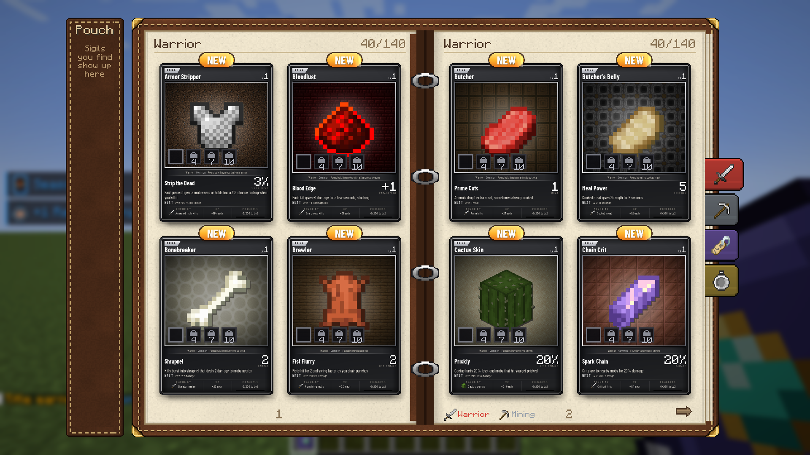
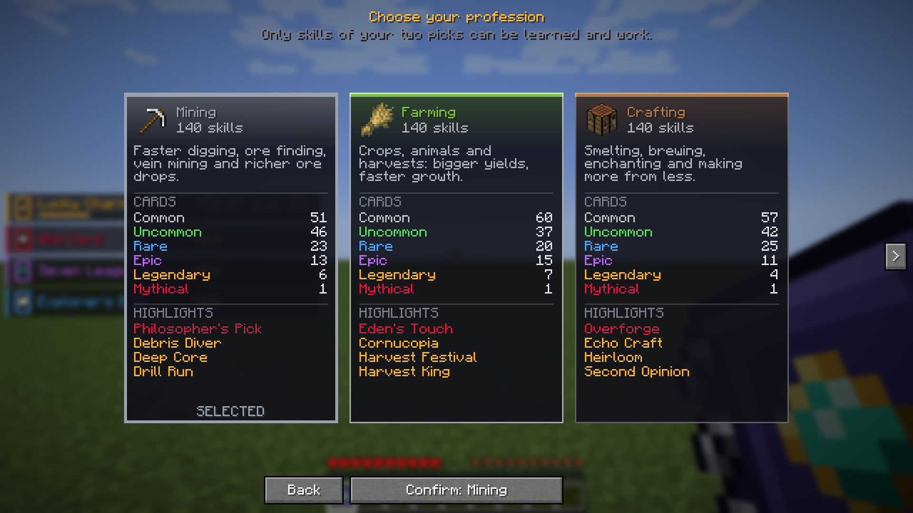

# Habits

A Minecraft Java Edition mod (NeoForge, Minecraft 1.21.1) that rewards what you already do. Every action, such as mining, farming, fighting or crafting, can earn a skill card, and cards level up passive perks as you keep doing that action.




## What it does

- 1,624 skill cards across 10 categories and 6 rarities (common to mythical), defined as JSON data files.
- Cards gain XP from the action they belong to and level up their perk. Players collect them in a binder.
- Players specialise in two areas (a combat style and a profession by default, or two professions via a config option), with 30 classes and 44 titles on top.
- Crafted gear rolls a quality rating (Normal, Rare, Epic, Unique, Legendary, Myth) and can be enhanced from +1 to +10.

## Tech

- Java 21, NeoForge 21.1.251, ModDevGradle, Gradle
- Mixin (82 mixin classes) to hook into vanilla game code
- NeoForge GameTest framework (397 in-game tests) and JUnit 5 (35 unit tests, including one that loads every skill file)
- Python scripts in `tools/` that generate textures and skill data

## How I built it

I built this with Claude and Claude Code. I set the design and the rules for each feature, and Claude wrote most of the code. My job was to break features down into clear specs, review the output, play-test it, and send back bugs until the tests and the game agreed.

One real problem: the mason's wand could duplicate items. Placing copies of a double slab only charged one slab item, but breaking each copy dropped two. The fix counts what each block is really worth (two for a double slab, the count for stacked blocks such as layers and candles) and charges that many items. A GameTest now places 30 slabs as double slabs and checks that exactly 15 are built with none left over.

## How to run it

You need JDK 21.

```
./gradlew build                 # builds build/libs/habits-0.1.0.jar
./gradlew runClient             # starts Minecraft with the mod loaded
./gradlew runGameTestServer     # runs the in-game tests
```

To play it normally, put the jar in the `mods` folder of a NeoForge 1.21.1 install.

## Licence

All rights reserved. The code is shared so it can be read; it is not licensed for reuse.
